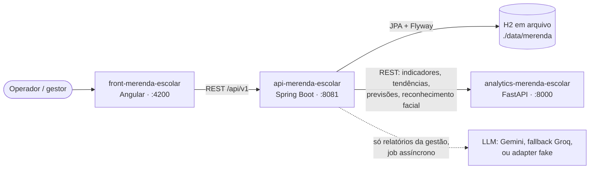

# API — Controle de Merenda Escolar

Backend do protótipo acadêmico de Controle de Merenda Escolar, desenvolvido com Java 25, Spring Boot 3.5, Spring Data JPA, H2, Flyway e Spring AI.

A API tem duas responsabilidades, com regras opostas:

- **Fila:** valida o consumo de cada aluno, por QR Code ou reconhecimento facial, de forma síncrona e sem IA.
- **Gestão:** consolida o consumo, obtém indicadores do serviço Python e gera relatórios logísticos com LLM em jobs assíncronos.

A integração com IA fica isolada atrás de uma porta de aplicação (`AnaliseLogisticaPort`). Ela não participa e não pode ser dependência do fluxo da fila.

## Arquitetura

O protótipo é formado por três repositórios que rodam juntos:

| Repositório | Papel | Stack | Porta local |
|---|---|---|---|
| `front-merenda-escolar` | Telas: fila (QR Code e facial), cardápio, fechamento de turno, cadastro de alunos e turmas, dashboard | Angular 20, Tailwind 4, Chart.js, html5-qrcode | 4200 |
| `api-merenda-escolar` | Regras de negócio, persistência, auditoria da fila, consolidação, jobs de relatório com LLM | Spring Boot 3.5, Java 25, Spring AI, Flyway, H2 em arquivo | 8081 |
| `analytics-merenda-escolar` | Cálculos determinísticos (indicadores, tendências, previsão) e reconhecimento facial (DeepFace) | FastAPI, Python 3.12+ | 8000 |



Princípios que orientam o código (o porquê de cada um está em `api-merenda-escolar/DECISOES-TECNICAS.md`):

- **A fila é síncrona e nunca chama o LLM.** Autoriza ou bloqueia o consumo numa transação; indisponibilidade da IA não afeta a fila.
- **A gestão é assíncrona.** O relatório com IA vira um job persistido (`relatorio_ia`); o front consulta o status.
- **Número é calculado, não gerado.** Indicadores e a conclusão numérica saem de código determinístico; o LLM só redige a partir deles e recebe apenas dados agregados.
- **O serviço Python não é dono de tabela.** Tudo o que ele precisa chega no pedido; ele não guarda foto, embedding nem dado de domínio.
- **Item é identificado por id, nunca por nome.**

Ordem para subir localmente: analytics (8000) → API (8081) → front (4200).

## Por dentro da API

### Módulos

O código fica em `src/main/java/br/com/frankcardoso/merenda/`, um pacote por módulo:

| Módulo | O que faz |
|---|---|
| `aluno` | Cadastro de alunos (código público do QR Code, matrícula, ativo), transferência de turma e cadastro do rosto, guardando só o embedding. |
| `analytics` | Portas e adapters HTTP para o serviço Python: indicadores logísticos, previsão de consumo e tendência por item. |
| `biometria` | Porta de reconhecimento facial (gerar embedding e identificar 1:N), a regra que reúne os candidatos e decide, e o adapter HTTP para o DeepFace do serviço Python. Não tem endpoint próprio. |
| `cardapio` | Cardápio por data e turno, com itens que referenciam receita por id; exclusão lógica; backfill de `receitaId` em cardápios antigos. |
| `catalogo` | Receitas e ingredientes, carregados de `src/main/resources/dados/*.tsv`, e a listagem de receitas usada no cadastro de cardápio. |
| `fila` | Validação síncrona do consumo, resolução do turno pelo relógio e auditoria de consumo (`auditoria_consumo`). |
| `gestao` | Consolidação do consumo por dia e turno, montagem dos indicadores do dashboard (calculados no Python) e lista de cardápios analisáveis. Não tem tabela própria. |
| `historico` | Histórico sintético de consumo (de `historico-fake.tsv`) e os recortes dele que vão para o prompt: ranking, taxa e série diária por item. |
| `inteligencia` | Porta `AnaliseLogisticaPort` e adapters de LLM: fake (padrão), Gemini e Groq via Spring AI, com fallback Gemini → Groq. |
| `medicao` | Medição de sobra por item no fechamento do turno: porções preparadas e servidas, sobra não distribuída e resto no prato. |
| `relatorio` | Job do relatório com IA: criação, worker assíncrono, estados e persistência da fotografia dos indicadores e do resultado. |
| `shared` | Configuração transversal (relógio e fuso `America/Sao_Paulo`, executor assíncrono, CORS para `http://localhost:4200`), carga dos dados de demonstração e tradução de erros para `ProblemDetail`. |
| `turma` | Cadastro de turmas e enturmação: vínculo aluno–turma com vigência e sem sobreposição. |

### Camadas dentro de um módulo

Os módulos usam as mesmas quatro subpastas, conforme precisam:

| Camada | Conteúdo | Exemplo |
|---|---|---|
| `api` | Controllers REST e DTOs (records de request e response). | `fila/api/FilaController`, `ValidarConsumoRequest` |
| `application` | Serviços com as regras e a orquestração. Em `application/port` ficam as interfaces para sistemas externos. | `fila/application/ValidacaoConsumoService`, `biometria/application/port/ReconhecimentoFacialPort` |
| `domain` | Entidades JPA, enums e exceções de domínio. | `fila/domain/AuditoriaConsumo`, `Turno` |
| `infrastructure` | Repositórios Spring Data, loaders de dados e adapters que implementam as portas (`infrastructure/python`, `gemini`, `groq`, `fake`, `fallback`). | `biometria/infrastructure/python/PythonReconhecimentoFacialAdapter` |

Nem todo módulo tem as quatro: `catalogo` não tem `application` (o controller lê o repositório direto), `gestao` só tem `api` e `application`, e `analytics`, `biometria` e `inteligencia` não expõem endpoint. A separação é por convenção, não uma arquitetura hexagonal estrita: as entidades de domínio são JPA, alguns serviços recebem ou devolvem DTOs da camada `api` (por exemplo, `ValidacaoConsumoService` e `CardapioService`) e um módulo pode usar o repositório de outro (a fila lê `AlunoRepository` e `CardapioRepository`).

### Fluxo da fila (síncrono)

`POST /api/v1/fila/validacoes` chama `ValidacaoConsumoService.validar`. Tudo acontece dentro da requisição. A fila nunca chama o LLM e só chama o serviço Python no modo facial.

1. **Turno pelo relógio** (fuso `America/Sao_Paulo`): antes das 12h é `MANHA`, antes das 18h é `TARDE`, antes das 23h é `NOITE`; das 23h à meia-noite bloqueia com `FORA_DO_TURNO`. A fila nunca resolve `INTEGRAL`, que é modalidade do aluno e não faixa de horário.
2. Se `metodoIdentificacao` é `FACIAL`, identifica o aluno pela foto, **antes** da transação, para a chamada ao analytics não segurar conexão de banco (ver [Identificação facial](#identificação-facial)). Se não identifica, bloqueia com o motivo do facial.
3. Numa transação, busca o aluno **ativo**, com lock pessimista para evitar dupla autorização concorrente: pelo `alunoCodigo` (código público) no QR Code, pelo aluno já identificado no facial. Sem aluno: `ALUNO_NAO_ENCONTRADO_OU_INATIVO`.
4. Busca o cardápio ativo da data e do turno. Sem cardápio: `CARDAPIO_NAO_CONFIGURADO`.
5. Se o aluno já teve consumo autorizado no mesmo dia e turno dentro da janela `merenda.fila.bloqueio-repeticao` (padrão `2m`), bloqueia com `CONSUMO_RECENTE_BLOQUEADO`. Depois da janela, o mesmo aluno pode validar de novo no turno atual.
6. Autoriza e grava a linha em `auditoria_consumo` com a turma vigente carimbada (`turma_id`/`turma_nome`, ou `Sem turma`).

A resposta de negócio é sempre HTTP 200: `resultado` `AUTORIZADO` com `sinal` `VERDE`, ou `BLOQUEADO` com `sinal` `VERMELHO` e `motivo`. Entrada inválida (por exemplo, `QR_CODE` sem `alunoCodigo`) volta como `ProblemDetail` 400. Só a autorização e o bloqueio por repetição são gravados em `auditoria_consumo`; os demais bloqueios, inclusive os do facial, voltam na resposta sem registro.

### Fluxo do relatório com IA (assíncrono)

```mermaid
sequenceDiagram
    participant F as Front
    participant S as RelatorioIAService
    participant W as RelatorioIAWorker
    participant P as analytics (porta 8000)
    participant L as AnaliseLogisticaPort
    F->>S: POST /api/v1/relatorios-ia
    S->>S: valida a amostra e grava relatorio_ia (PENDENTE)
    S-)W: processar(relatorioId) no relatorioExecutor
    S-->>F: 202 Accepted com relatorioId e statusUrl
    W->>P: indicadores, previsão e tendência por item
    W->>W: payload agregado e conclusão determinística (PROCESSANDO)
    W->>L: analisar(input), com timeout
    W->>W: classificação vem do código; grava CONCLUIDO ou FALHOU
    F->>S: GET /api/v1/relatorios-ia/{id} até CONCLUIDO ou FALHOU
```

1. `RelatorioIAService.criar` valida a amostra: pelo menos 20 dias com fechamento nos 30 dias até `dataReferencia` e, para cada receita escolhida, pelo menos 3 dias medidos. Grava `relatorio_ia` como `PENDENTE` e entrega o id ao worker.
2. `RelatorioIAWorker.processar` é `@Async("relatorioExecutor")` (`AsyncConfig`: 1 a 2 threads, fila de 20), fora do caminho da fila:
   - consolida o consumo do dia e turno (`ConsolidacaoConsumoService`);
   - pede os indicadores ao Python (`POST /api/v1/indicadores-logisticos`); se falhar, os indicadores ficam `INDISPONIVEL`;
   - pede a previsão de consumo (`POST /api/v1/previsoes-consumo`); se falhar, segue com `previsaoConsumo: null` e um aviso;
   - junta o histórico (Java) com a tendência por item (`POST /api/v1/tendencias-item`); se falhar, segue sem tendência;
   - monta `AnaliseLogisticaInput` só com agregados e a `ConclusaoDeterministica`, grava a fotografia dos indicadores e passa a `PROCESSANDO`;
   - chama a `AnaliseLogisticaPort` com timeout `merenda.ia.timeout-segundos`;
   - substitui `nivelAceitacao` e `riscoDesperdicio` pela conclusão determinística, valida a estrutura e grava `CONCLUIDO`. Qualquer exceção grava `FALHOU` com a mensagem do erro.
3. O front consulta `GET /api/v1/relatorios-ia/{id}`. A consulta lê o que foi persistido; não recalcula nem chama IA.

## Execução local

### Pré-requisitos

- **JDK 25** (`java.version` no `pom.xml`).
- **Maven 3.9+**. O `.mvn/wrapper/maven-wrapper.properties` fixa o Maven 3.9.16, mas os scripts `mvnw`/`mvnw.cmd` não estão no repositório (ver [Pendências](#pendências-e-próximos-passos)); use um Maven instalado. `mvn -v` deve mostrar Maven 3.9+ rodando sobre o JDK 25.
- Serviço `analytics-merenda-escolar` em `http://localhost:8000` para indicadores e reconhecimento facial. A API sobe sem ele (ver [Dependência do analytics](#dependência-do-analytics)).
- Chave do Gemini **somente** para o profile de IA real. A execução padrão usa o adapter fake e não precisa de chave nem de internet.

### Subir a API

Rode da raiz do repositório: o caminho do banco é relativo ao diretório de onde a API é iniciada.

```bash
JAVA_HOME=/caminho/para/jdk-25 mvn -B spring-boot:run
```

```powershell
$env:JAVA_HOME = "C:\caminho\para\jdk-25"
mvn -B spring-boot:run
```

| Endereço | URL |
|---|---|
| API | `http://localhost:8081` (`server.port`) |
| Health check | `http://localhost:8081/actuator/health` |
| Swagger UI | `http://localhost:8081/swagger-ui.html` |
| OpenAPI (JSON) | `http://localhost:8081/v3/api-docs` |

O Actuator expõe só `health` e `info`. O CORS de `/api/**` libera apenas `http://localhost:4200`.

### Banco H2 e migrations

- URL: `jdbc:h2:file:./data/merenda;MODE=PostgreSQL;AUTO_SERVER=TRUE`, usuário `sa`, senha vazia. O arquivo é `data/merenda.mv.db`; a pasta `data/` está no `.gitignore`.
- O console web do H2 não está habilitado. Com `AUTO_SERVER=TRUE`, um cliente externo (por exemplo, o Database do IntelliJ) pode abrir o mesmo arquivo com a API no ar.
- O schema é do Flyway: migrations em `src/main/resources/db/migration` (`V1` a `V13`; não existe `V12`). O Hibernate roda com `ddl-auto: validate`, então mudança de entidade sem migration impede a subida.
- Nos testes, o banco é H2 em memória (ver [Testes](#testes)).

### Zerar o banco local

Para começar de um banco vazio, pare a API, apague os arquivos `data/merenda*` (`merenda.mv.db` e, se existirem, `merenda.lock.db` e `merenda.trace.db`) e suba de novo:

```bash
rm -f data/merenda*
```

O Flyway recria o schema e os loaders recarregam catálogo, histórico, medições e [dados de demonstração](#dados-de-demonstração). Isso apaga também cardápios, consumos, rostos e relatórios criados à mão.

### Variáveis de ambiente

Estas são as variáveis lidas pela configuração. Nenhum valor de chave fica no repositório.

| Variável | Onde é lida | Padrão | Para quê |
|---|---|---|---|
| `MERENDA_ANALYTICS_BASE_URL` | `application.yml` | `http://localhost:8000` | Endereço do analytics (indicadores, previsão, tendência e reconhecimento facial). |
| `MERENDA_ANALYTICS_TIMEOUT` | `application.yml` | `2s` | Timeout de indicadores, previsão e tendência. O facial usa `merenda.reconhecimento.timeout`. |
| `GEMINI_API_KEY` | `application-gemini.yml` | sem padrão | Chave do Gemini no profile `gemini`, quando não vem do `application-local.yml`. |
| `GEMINI_MODEL` | `application-gemini.yml` | `gemini-3.6-flash` | Modelo do Gemini. |
| `GROQ_API_KEY` | `GroqClientConfig` | vazio | Chave do fallback Groq no profile `gemini`; também pode ficar no `application-local.yml`. |
| `GROQ_MODEL` | `application-gemini.yml` | `openai/gpt-oss-20b` | Modelo do fallback Groq. |

O adapter de IA que roda depende só do profile Spring `gemini` (ver [Configuração da IA](#configuração-da-ia-fake-gemini-e-groq)). Sem ele, roda o adapter fake.

### Outras propriedades

| Propriedade | Padrão | Efeito |
|---|---|---|
| `merenda.fila.bloqueio-repeticao` | `2m` | Janela de bloqueio de repetição na fila. |
| `merenda.gestao.meta-execucao-percentual` | `80` | Meta interna de execução do planejamento (entre 0 e 100). |
| `merenda.ia.timeout-segundos` | `30` (`50` no profile `gemini`) | Tempo máximo da chamada ao LLM no worker. |
| `merenda.ia.provedor` / `merenda.ia.modelo` | `fake` / `regras-locais-v1` | Rótulos gravados no relatório quando o processamento começa; não escolhem o adapter. |
| `merenda.reconhecimento.timeout` | `10s` | Timeout das chamadas de reconhecimento facial (padrão só no código). |
| `merenda.medicao.escola-id` | `1` | Escola única do protótipo nas medições e nos indicadores (padrão só no código). |
| `merenda.medicao.dias-janela-ingredientes` | `180` | Janela, em dias, das medições usadas na análise por ingrediente (padrão só no código). |
| `merenda.demo.dias` / `merenda.demo.alunos` | `60` / `150` | Ver [Dados de demonstração](#dados-de-demonstração). |

Para mudar uma propriedade numa execução, passe-a como argumento, por exemplo `mvn -B spring-boot:run -Dspring-boot.run.arguments=--merenda.demo.dias=0`.

### Dependência do analytics

A API sobe e a fila por QR Code funciona sem o analytics. Sem ele:

- `GET /api/v1/gestao/indicadores` responde `status=INDISPONIVEL`, com indicadores nulos e aviso seguro;
- o relatório com IA segue sem previsão e sem tendência (ver [Relatório logístico](#relatório-logístico));
- o cadastro de rosto responde 503 e a validação `FACIAL` na fila bloqueia com `RECONHECIMENTO_FACIAL_INDISPONIVEL`: não há fallback para o reconhecimento facial, e o QR Code segue funcionando.

O primeiro pedido de reconhecimento facial depois de subir o analytics baixa os pesos do modelo (cerca de 90 MB); por isso o timeout do facial é maior que o dos outros adapters. O detector `opencv` também baixa dois classificadores de github.com no primeiro uso (ver [Roteiro da demonstração facial](#roteiro-da-demonstração-facial)).

## Dados de demonstração

Na subida, fora do profile `test`, a API popula o banco para o dashboard ter números sem que alguém precise bipar centenas de QR Codes. A ordem é esta:

| Ordem | Componente | O que cria | Quando |
|---|---|---|---|
| 0 | `DadosIniciaisConfig` (`CommandLineRunner`, `@Profile("!test")`) | Alunos `ALU-001` Ana Souza, `ALU-002` Bruno Lima e `ALU-003` Carla Santos. | Só com a tabela `aluno` vazia. |
| 1 | `CatalogoLoader` | Receitas e ingredientes de `dados/itens-catalogo.tsv` e `dados/receitas-ingredientes.tsv`. | Tabelas vazias. |
| 2 | `HistoricoFakeLoader` | Histórico sintético de `dados/historico-fake.tsv`, insumo do prompt. | Tabela vazia. |
| 3 | `MedicaoSobraFakeLoader` | Medição sintética de `dados/medicao-sobra-fake.tsv`. | Tabela vazia. |
| 4 | `CardapioReceitaBackfill` | `receitaId` dos itens de cardápios antigos, por nome exato. | Itens sem id. |
| 5 | `RostosDemonstracaoLoader` (`@Profile("!test")`) | Alunos `ALU-9001` a `ALU-9005` com o rosto já cadastrado (abaixo). | Só o que falta. |
| 6 | `DadosDemonstracaoLoader` (`@Profile("!test")`) | Alunos, turmas, enturmações, cardápios, consumos e medições (abaixo). | Só o que falta. |

O `DadosIniciaisConfig` roda antes de tudo, na subida do contexto. Os componentes 1 a 6 escutam `ApplicationReadyEvent`, com o `@Order` no método ouvinte (o Spring ignora `@Order` na classe para métodos `@EventListener`); `OrdemDosLoadersTest` guarda essa ordem. Só o 5 e o 6 têm restrição de profile: os demais rodam também nos testes com contexto Spring. Os arquivos `.tsv` ficam em `src/main/resources/dados/` e são gerados por `scripts/gerar_historico_fake.py`.

O `DadosDemonstracaoLoader` (`shared/config`, `@Order(6)`) trabalha a partir da data de hoje no fuso `America/Sao_Paulo` e cria:

- **Alunos** até completar `merenda.demo.alunos`, com nome `Aluno Demonstracao N`. Os alunos já existentes entram na conta; com os três iniciais, os cinco com rosto e o padrão de 150, vão de `ALU-0009` a `ALU-0150`. Esses alunos não têm rosto cadastrado.
- **Turmas** `1A` a `9A` (turno `MANHA`, capacidade 30) e a **enturmação** de cada aluno sem vínculo, desde antes do primeiro dia do histórico. Um aluno é transferido para a turma seguinte no meio do intervalo, para a transferência ter o que mostrar.
- **Cardápios** de demonstração (300 refeições planejadas, descrição `Cardapio de demonstracao`, itens do catálogo) para `MANHA`, `TARDE` e `INTEGRAL` em cada dia útil dos últimos `merenda.demo.dias` dias até hoje. Hoje ganha cardápio em **todos** os turnos, inclusive `NOITE` e fim de semana, sem consumo além do que já passou, para a fila funcionar a qualquer hora da apresentação.
- **Consumos** em `auditoria_consumo`, nunca com instante depois de agora e nunca para os alunos que têm rosto cadastrado (o consumo sintético em nome deles bloquearia a primeira leitura ao vivo por consumo recente): adesão em torno de 31% do planejado (cenário de desperdício alto, como no dado real), repetições mais frequentes nas turmas menores (1A a 3A), bloqueios em torno de 4% das autorizações e cerca de 1 em cada 10 registros marcado como `FACIAL`.
- **Medições de sobra** sintéticas (origem `SINTETICO`) do cardápio principal do `INTEGRAL`, em cada dia útil.

**Alunos com rosto (`RostosDemonstracaoLoader`).** Lê `src/main/resources/demo/rostos-demo.json` (propriedade `merenda.demo.rostos`, padrão `classpath:demo/rostos-demo.json`) e cria `ALU-9001` Helena Duarte, `ALU-9002` Lívia Campos, `ALU-9003` Rafael Moreira, `ALU-9004` Otávio Brandão e `ALU-9005` Lucas Ferreira, com o embedding já calculado. Os nomes são fictícios; os rostos vêm de adultos do dataset público LFW, e o JSON guarda só vetores, nenhuma imagem. É idempotente: não duplica, e só preenche o embedding de quem existe sem rosto. Semente ausente ou ilegível vira log, não falha a subida. O JSON é gerado por `analytics-merenda-escolar/scripts/gerar_rostos_demo.py`.

**Idempotência:** o `DadosDemonstracaoLoader` só cria o que falta. Turmas são procuradas pelo código, a enturmação só é feita para quem não tem vínculo, o cardápio só é criado onde não há cardápio ativo no dia e turno, e a medição só onde ainda não existe. O consumo só é gerado para dia e turno sem nenhuma autorização registrada, o que preserva o que foi bipado pela tela da fila. Reiniciar não duplica dados; a cada subida o loader completa os dias que faltam até hoje. Cardápios de demonstração antigos, sem `receitaId`, são corrigidos.

**Configuração:**

| Propriedade | Padrão | Efeito |
|---|---|---|
| `merenda.demo.dias` | `60` | Dias de histórico gerados. `0` ou negativo desliga o `DadosDemonstracaoLoader` inteiro. |
| `merenda.demo.alunos` | `150` | Quantidade total de alunos que o loader garante. |
| `merenda.demo.rostos` | `classpath:demo/rostos-demo.json` | Semente dos alunos com rosto (`RostosDemonstracaoLoader`). |

Nenhuma delas está no `application.yml`; valem os padrões do código. Os três alunos de `DadosIniciaisConfig` não dependem das duas primeiras, e `merenda.demo.dias` não desliga o `RostosDemonstracaoLoader`.

## Endpoints REST

Os endpoints de negócio ficam sob `/api/v1` e trocam JSON. Entrada inválida, recurso inexistente e conflito voltam como `ProblemDetail` (400, 404 e 409). Os schemas completos estão no Swagger.

| Módulo | Método e caminho | O que faz |
|---|---|---|
| `aluno` | `GET /api/v1/alunos` | Lista por nome. Traz `temRostoCadastrado`, mas `turmaVigente` e `historicoVinculos` vêm nulos. |
| `aluno` | `GET /api/v1/alunos/{id}` | Detalhe com `turmaVigente`, `historicoVinculos` e `temRostoCadastrado`. |
| `aluno` | `POST /api/v1/alunos` | Cria (201). `codigoPublico` é obrigatório; `turmaId` e `dataInicio`, informados juntos, abrem o primeiro vínculo. Código público ou matrícula repetidos: 409. |
| `aluno` | `PUT /api/v1/alunos/{id}` | Atualiza `matricula`, `nome` e `ativo` (obrigatório). O código público não muda; a turma só muda por transferência. |
| `aluno` | `POST /api/v1/alunos/{id}/transferencias` | `{"turmaId", "dataMudanca"}`: fecha o vínculo vigente no dia anterior e abre o novo. |
| `aluno` | `POST /api/v1/alunos/{id}/rosto` | `{"fotoBase64"}`: gera o embedding no analytics e guarda só o vetor. Foto sem rosto ou com mais de um rosto: 400. Rosto já cadastrado em outro aluno ativo: 409. Analytics fora do ar: 503. |
| `turma` | `GET /api/v1/turmas` e `GET /api/v1/turmas/{id}` | Lista e detalhe. |
| `turma` | `POST /api/v1/turmas` | Cria (201): `codigo`, `descricao`, `turno`, `quantidadeMaximaAlunos`. Código repetido: 409. |
| `turma` | `PUT /api/v1/turmas/{id}` | Atualiza. |
| `turma` | `DELETE /api/v1/turmas/{id}` | Exclui (204). Turma com enturmações, atuais ou históricas, ou com consumos: 409. |
| `fila` | `POST /api/v1/fila/validacoes` | `{"alunoCodigo", "metodoIdentificacao", "fotoBase64"}`, com `metodoIdentificacao` `QR_CODE` (exige `alunoCodigo`, senão 400) ou `FACIAL` (exige só `fotoBase64`; `alunoCodigo` é ignorado): autoriza ou bloqueia o consumo; bloqueio de negócio também volta 200. |
| `cardapio` | `GET /api/v1/cardapios` | Cardápios ativos, do mais recente para o mais antigo. |
| `cardapio` | `POST /api/v1/cardapios` | Cria (201): `data`, `turno`, `nomeRefeicao`, `descricao`, `itens` (`receitaId`, `nome`, `quantidade`) e `quantidadePlanejada`. Data passada ou receita desconhecida: 400; cardápio ativo já existente no dia e turno: 409. |
| `cardapio` | `PUT /api/v1/cardapios/{id}` | Atualiza. |
| `cardapio` | `DELETE /api/v1/cardapios/{id}` | Desativa (exclusão lógica, 204); a linha continua referenciada pela auditoria. |
| `catalogo` | `GET /api/v1/receitas` | Receitas ativas, por nome, para o cadastro de cardápio escolher por id. |
| `medicao` | `GET /api/v1/medicoes-sobra?data=&turno=` | Medições do dia e turno. |
| `medicao` | `POST /api/v1/medicoes-sobra` | Lança a medição de um item; relançar o mesmo item no mesmo dia e turno sobrescreve. A receita precisa estar no cardápio ativo do dia e turno. |
| `medicao` | `POST /api/v1/medicoes-sobra/fechamento` | `{"medicoes": [...]}`: fechamento do turno, todos os itens com a mesma data e turno. |
| `gestao` | `GET /api/v1/gestao/consolidacoes?data=&turno=` | Consolidação determinística do consumo do dia e turno. |
| `gestao` | `GET /api/v1/gestao/cardapios-analise?inicio=&fim=&turno=` | Cardápios servidos no período, agrupados pelas receitas, com as datas de fechamento completo. |
| `gestao` | `GET /api/v1/gestao/indicadores?data=&turno=` | Indicadores do dashboard, calculados no analytics. Parâmetros opcionais: `receitaIds` e `datas`. |
| `relatorio` | `POST /api/v1/relatorios-ia` | Cria o job (202 com `Location`): `dataReferencia`, `turno` e, opcionais, `receitaIds`, `datasSelecionadas` e `turmaId`. |
| `relatorio` | `GET /api/v1/relatorios-ia?data=&turno=` | Últimos 20 relatórios do filtro, mais recentes primeiro. |
| `relatorio` | `GET /api/v1/relatorios-ia/{id}` | Status, resultado e a fotografia de `indicadores` do relatório. |

Fora de `/api/v1`: `GET /actuator/health`, `GET /actuator/info`, `/swagger-ui.html` e `/v3/api-docs`.

### Identificação facial

A identificação facial é **1:N**: a foto descobre quem é o aluno, sem o operador digitar código. O QR Code continua sendo o caminho de reserva.

**Cadastro do rosto.** `POST /api/v1/alunos/{id}/rosto` com `{"fotoBase64": "..."}`. A API envia a foto ao analytics (`POST /api/v1/reconhecimento-facial/embeddings`, modelo `Facenet`, exatamente um rosto) e grava só o vetor devolvido, em `aluno.rosto_embedding_json` (migration `V13`). A foto nunca é gravada, nem na API nem no analytics. Antes de gravar, a API compara o rosto novo com os já cadastrados: se ele já pertence a outro aluno ativo, responde 409 com "Este rosto já está cadastrado para o aluno <código> (<nome>)."; sem isso, dois cadastros do mesmo rosto tornariam o reconhecimento sempre ambíguo. Recadastrar o rosto do próprio aluno é permitido e substitui o anterior. Analytics fora do ar: 503.

**Validação na fila.** `POST /api/v1/fila/validacoes` com `metodoIdentificacao` `FACIAL` precisa só da foto:

```json
{ "metodoIdentificacao": "FACIAL", "fotoBase64": "..." }
```

A API carrega os alunos ativos com rosto e pede ao analytics a identificação 1:N (`POST /api/v1/reconhecimento-facial/identificacoes`), mandando a foto e os embeddings dos candidatos. O analytics escolhe o maior rosto da foto, compara com todos os candidatos e só devolve `RECONHECIDO` se a menor distância estiver abaixo do limiar (0.4, Facenet com cosseno) **e** o segundo colocado estiver pelo menos 0.08 mais longe; senão `AMBIGUO` ou `NAO_RECONHECIDO`. Candidato com embedding de outra dimensão é ignorado e contado (a API registra aviso no log). Reconhecido o aluno, valem as mesmas regras do QR Code (cardápio do turno, repetição, carimbo de turma) e a auditoria registra o método `FACIAL`.

Os bloqueios próprios do facial, todos sem auditoria porque não há aluno a associar:

| Motivo | Quando |
|---|---|
| `FOTO_NAO_INFORMADA` | Sem `fotoBase64`. |
| `NENHUM_ROSTO_CADASTRADO` | Nenhum aluno ativo tem rosto. |
| `ROSTO_NAO_RECONHECIDO` | Menor distância acima do limiar. |
| `ROSTO_AMBIGUO` | Dois cadastros próximos demais para decidir. |
| `ROSTO_NAO_DETECTADO` | A foto não tem rosto detectável. |
| `RECONHECIMENTO_FACIAL_INDISPONIVEL` | Analytics fora do ar, erro 5xx ou resposta malformada. Nunca vira 500. |

Com `QR_CODE`, `alunoCodigo` é obrigatório e `fotoBase64` é ignorado. O porquê das decisões, a calibração medida e o que faltaria para produção (LGPD incluída) estão em [DECISOES-TECNICAS.md](DECISOES-TECNICAS.md), seção 8.

### Roteiro da demonstração facial

Pré-requisito, uma vez por máquina, **com internet**: o detector `opencv` baixa `haarcascade_frontalface_default.xml` e `haarcascade_eye.xml` de github.com para `~/.deepface/weights/` no primeiro uso, e os pesos do Facenet (cerca de 90 MB) vêm na primeira requisição. Faça um primeiro reconhecimento antes de apresentar, para não esbarrar no timeout nem na rede.

1. Suba os três serviços: analytics (8000), API (8081) e front (4200). Os cinco alunos de exemplo (`ALU-9001` a `ALU-9005`) já nascem com rosto cadastrado.
2. Na fila, escolha o modo facial e use **Usar imagem** com `demo/rostos-teste/ALU-9001-teste.jpg`: o cartão fica verde com o nome de Helena Duarte. Repita com `ALU-9002` a `ALU-9005-teste.jpg`; cada imagem autoriza o aluno certo. As imagens de teste são diferentes das usadas no cadastro (origem e citação em `demo/rostos-teste/README.md`).
3. Use `demo/rostos-teste/desconhecido.jpg`: a leitura é bloqueada com "Rosto não reconhecido" e a tela orienta o QR Code.
4. Repita uma das imagens em menos de 2 minutos: bloqueio por consumo recente.
5. Para ser reconhecido você mesmo: em **Alunos**, crie um aluno novo, abra o detalhe, **Cadastrar rosto** (câmera ou **Usar imagem**) e volte à fila no modo facial.
6. Para voltar ao estado inicial, pare a API e apague `data/merenda*` (ver [Zerar o banco local](#zerar-o-banco-local)).

A foto de teste mostrada à webcam também passa: não há prova de vida (ver limitações).

## Configuração da IA (fake, Gemini e Groq)

Por padrão, a API sobe em modo fake/offline. Nesse modo, o `application.yml` define:

```yaml
spring:
  ai:
    model:
      chat: none

merenda:
  ia:
    provedor: fake
    modelo: regras-locais-v1
```

O adapter é escolhido **exclusivamente pelo profile Spring `gemini`**:

- **Sem o profile (padrão):** `FakeAnaliseLogisticaAdapter`, determinístico, sem rede e sem chave. Existe para testes e demonstrações offline.
- **Com o profile `gemini`:** `FallbackAnaliseLogisticaAdapter` (`@Primary`) chama o Gemini e, se ele falhar por qualquer motivo (erro, timeout, indisponibilidade), tenta o Groq, pela API compatível com OpenAI. O relatório grava o provedor e o modelo que de fato responderam.

Com o profile `gemini` ativo, o Spring Boot carrega automaticamente:

```text
application.yml
application-gemini.yml
```

O arquivo [application-gemini.yml](src/main/resources/application-gemini.yml) configura o Spring AI com `google-genai`, troca o provedor interno para `gemini`, fixa `temperature: 0.0` e `max-output-tokens: 4096` (os comentários do arquivo explicam o porquê), sobe o timeout do worker para 50 s e configura o fallback Groq.

O projeto também tem profiles Maven que servem de atalho para os profiles Spring durante o `spring-boot:run`:

| Profile Maven | Profiles Spring ativados |
|---|---|
| `-Pgemini` | `gemini` |
| `-Plocal` | `gemini,local` |

**Com arquivo local.** Copie o exemplo Spring para um arquivo local ignorado pelo Git:

```bash
cp src/main/resources/application-local.example.yml src/main/resources/application-local.yml
```

```powershell
Copy-Item src\main\resources\application-local.example.yml src\main\resources\application-local.yml
```

Depois edite `src/main/resources/application-local.yml` e preencha a chave do Gemini e, se quiser o fallback, a do Groq:

```yaml
spring:
  ai:
    google:
      genai:
        api-key: sua-chave-gemini

GROQ_API_KEY: sua-chave-groq
```

O `application-local.yml` real não deve ser versionado; ele está no `.gitignore`. Com o arquivo configurado, rode com o profile Maven `local`:

```bash
mvn -B spring-boot:run -Plocal
```

Esse profile Maven ativa os profiles Spring `gemini,local`. Assim o Spring carrega:

```text
application.yml
application-gemini.yml
application-local.yml
```

**Com variável de ambiente.** Se preferir não criar arquivo local, use o profile Maven `gemini` e informe a chave por variável de ambiente:

```bash
GEMINI_API_KEY=sua-chave mvn -B spring-boot:run -Pgemini
```

```powershell
$env:GEMINI_API_KEY = "sua-chave"
mvn -B spring-boot:run -Pgemini
```

No IntelliJ, configure uma Run Configuration com:

- `Active profiles`: `gemini,local`
- `Environment variables`: opcionalmente `GEMINI_API_KEY=sua-chave`, caso não use `application-local.yml`

O modelo padrão do profile `gemini` é `gemini-3.6-flash`, que pode ser trocado por `GEMINI_MODEL`. Em contas ou projetos novos, o Google pode retornar HTTP 404 para `gemini-2.5-flash` com a mensagem de que o modelo não está mais disponível para novos usuários.

A IA fica desativada por padrão para que a fila funcione sem credenciais ou internet. Somente informações agregadas podem ser enviadas ao modelo. Nomes, matrículas, identificadores e biometria não fazem parte do payload de IA.

O tier gratuito é adequado ao protótipo e não deve ser tratado como capacidade garantida de produção. Os limites efetivos variam por projeto e modelo e devem ser consultados no Google AI Studio. No tier gratuito, o Google informa que o conteúdo pode ser usado para melhorar seus produtos; por isso, este projeto envia somente indicadores agregados e nunca dados identificáveis ou biométricos.

## Relatório logístico

Durante a geração do relatório, a API Java consolida os dados da fila, chama o serviço Python de analytics e envia o resultado como insumo adicional para a IA:

```text
RelatorioIAWorker
  -> ConsolidacaoConsumoService
  -> Python Analytics /api/v1/indicadores-logisticos
  -> Python Analytics /api/v1/previsoes-consumo
  -> Histórico (Java) + Python Analytics /api/v1/tendencias-item
  -> AnaliseLogisticaPort (fake, ou Gemini com fallback Groq)
  -> RelatorioIA persistido
```

O passo a passo está em [Fluxo do relatório com IA](#fluxo-do-relatório-com-ia-assíncrono). O serviço Python é acessado por padrão em `http://localhost:8000`, configurável por `MERENDA_ANALYTICS_BASE_URL`. O timeout padrão é `2s`, configurável por `MERENDA_ANALYTICS_TIMEOUT`.

Se o serviço Python estiver indisponível, o relatório continua sendo gerado com os dados consolidados em Java. Nesse caso, o input enviado para a IA recebe `previsaoConsumo: null` e `avisoPrevisaoConsumo` com a falha segura. Isso evita que uma API auxiliar derrube a demonstração.

Primeiro consulte a consolidação determinística:

```http
GET /api/v1/gestao/consolidacoes?data=2026-08-26&turno=MANHA
```

Crie o job assíncrono de análise (os campos opcionais `receitaIds`, `datasSelecionadas` e `turmaId` restringem o escopo; ver [Estado atual](#estado-atual--análise-por-cardápio)):

```http
POST /api/v1/relatorios-ia
Content-Type: application/json

{
  "dataReferencia": "2026-08-26",
  "turno": "MANHA"
}
```

A resposta HTTP `202 Accepted` informa o `relatorioId` e a URL de acompanhamento (`statusUrl` e cabeçalho `Location`). Consulte-a até o status chegar a `CONCLUIDO` ou `FALHOU`:

```http
GET /api/v1/relatorios-ia/{relatorioId}
```

Os estados persistidos são `PENDENTE`, `PROCESSANDO`, `CONCLUIDO` e `FALHOU`. O processamento ocorre em executor separado e não compartilha o caminho crítico da fila.

## Dashboard logístico — indicadores v2 (contrato `schemaVersion=4`)

Atualize e reinicie também o serviço Python antes de testar esta versão. O cálculo novo usa
`POST /api/v1/indicadores-logisticos` no Python; não chama o Gemini e não exige chave de IA.

- `GET /api/v1/gestao/indicadores?data=2026-09-17&turno=MANHA`: indicadores do dia e ranking histórico dos últimos 30 dias (inclusive a data de referência). `receitaIds` e `datas`, opcionais, restringem o escopo ao cardápio e às datas selecionadas.
- `GET /api/v1/relatorios-ia?data=2026-09-17&turno=MANHA`: últimos 20 relatórios do filtro, mais recentes primeiro.
- `GET /api/v1/relatorios-ia/{id}`: inclui `indicadores`, a fotografia persistida usada no relatório; consultas não recalculam nem chamam IA.

O contrato Java↔Python está em `schemaVersion = "4"`: cada item de `porTurma` traz `turmaId`.
Relatórios persistidos nas versões "2" e "3" continuam abrindo.

A migration V5 adiciona `relatorio_ia.indicadores_json`. Relatórios anteriores continuam
consultáveis e retornam `indicadores: null`. Relatórios novos usam `promptVersao=v2-indicadores`.
O prompt compartilhado por Gemini/Groq está em
`inteligencia/infrastructure/chat/ChatClientAnaliseLogisticaAdapter.java`.

Configure a meta interna em `merenda.gestao.meta-execucao-percentual` (padrão 80, entre 0 e 100).
Ela mede autorizações de consumo / refeições planejadas, não aceitação sensorial nem desperdício
medido. Repetições e alunos únicos são separados por dia/turno. O percentual pode superar 100;
quando o planejamento é zero, o indicador é não avaliável, não zero.

O ranking inicial é de **execução registrada de itens**, com no mínimo 5 planejamentos.
Registros históricos com quantidade zero contam como execução registrada, enquanto quantidade
nula é ausência de registro. O ranking informa escolas e origens e não deve ser confundido
com a demanda da fila local. Dados `FAKE`/sintéticos continuam identificados pelas origens.
Para outras escolas, o próximo passo é modelar escola na fila e filtrar ambos os conjuntos.

Turmas exibem alunos/consumos/repetições pela turma **carimbada no consumo** (ver "Turmas e
enturmação"), apenas para turmas com atendimentos. Percentuais de adesão e metas por turma
permanecem `NAO_AVALIAVEL`: ter turma modelada não autoriza calcular adesão, que depende de
presença elegível. Ingredientes e rotação retornam `DADOS_INSUFICIENTES`:
faltam composição de receitas e séries comparáveis; nenhum ciclo de 15/30 dias é inventado.

Se o Python falhar, o endpoint retorna `status=INDISPONIVEL`, indicadores nulos e aviso seguro.
O relatório continua com as informações disponíveis. A fila não depende dessa integração.
Respostas de IA são validadas estruturalmente (campos e classificações); isso não garante
veracidade da narrativa. Números do dashboard nunca vêm da resposta do LLM.

## Turmas e enturmação

- `Turma` é entidade própria (código, descrição, turno, capacidade). `Aluno` não tem mais o
  campo `turma`; o vínculo é `Enturmacao`, com `dataInicio` e `dataFim` (nula = vigente).
- A migration **V10** cria `turma` e `enturmacao`, remove `aluno.turma` e adiciona
  `turma_id`/`turma_nome` em `auditoria_consumo`. **A V10 não preenche o carimbo das linhas de
  auditoria que já existiam**: ver "Limitações conhecidas".
- Enturmações do mesmo aluno não podem se sobrepor; a tentativa é rejeitada com 409. `vigenteEm`
  é tolerante: se chegar dado sobreposto de fora, escolhe a vigência mais recente em vez de
  derrubar a fila.
- A fila **carimba** `turmaId`/`turmaNome` em cada `AuditoriaConsumo` que grava, tanto na
  autorização quanto no bloqueio por repetição. O dashboard agrupa por esse carimbo, não pela
  turma atual do aluno: transferir um aluno não reescreve o passado.
- Consumo de aluno sem enturmação vigente na data cai no balde **"Sem turma"**, que entra
  normalmente na soma de Atendimentos.
- O `DadosDemonstracaoLoader` semeia 9 turmas (1A a 9A) e enturma os alunos de demonstração antes
  de gerar o consumo.

As rotas de alunos e turmas estão em [Endpoints REST](#endpoints-rest). Na transferência
(`POST /api/v1/alunos/{id}/transferencias` com `{"turmaId": "...", "dataMudanca": "2026-10-19"}`),
o vínculo vigente é fechado no dia anterior e o novo é aberto. `dataMudanca` precisa ser
posterior ao início do vínculo vigente (senão, HTTP 400); aluno sem vínculo vigente ou já na
turma de destino recebe 409.

## Estado atual — análise por cardápio

- A análise IA parte de um cardápio servido selecionado no período de 30 dias.
- Cardápios iguais são agrupados por suas receitas vinculadas ao catálogo.
- A amostra usa somente datas em que todos os itens do cardápio possuem fechamento completo.
- A geração exige no mínimo 20 dias completos; cada item selecionado exige pelo menos 3 dias medidos.
- É possível analisar o cardápio inteiro ou somente parte dos itens, mantendo as datas do cardápio selecionado.
- O backend reconfirma as datas no banco e não aceita datas parciais para compor os indicadores.
- Alterações no fechamento podem modificar indicadores e relatórios futuros; relatórios já persistidos permanecem como fotografia do momento da geração.

Os indicadores operacionais do dashboard usam o dia e turno de referência. Aceitação e desperdício
usam os fechamentos históricos do escopo selecionado. Autorizações da fila não comprovam presença,
ingestão, aceitação ou desperdício.

## Testes

```bash
# suíte inteira
JAVA_HOME=/caminho/para/jdk-25 mvn -B test

# uma classe
JAVA_HOME=/caminho/para/jdk-25 mvn -B test -Dtest=ValidacaoConsumoServiceTest
```

- Os testes ficam em `src/test/java/br/com/frankcardoso/merenda/`, espelhando os pacotes de `main`.
- Os testes com contexto Spring usam `@ActiveProfiles("test")` e `src/test/resources/application.yml`: H2 em memória (`jdbc:h2:mem:merenda-test`) e IA desligada (`spring.ai.model.chat: none`). Alguns sobrescrevem `spring.datasource.url` para ter um banco em memória próprio.
- Com o profile `test`, `DadosIniciaisConfig`, `RostosDemonstracaoLoader` e `DadosDemonstracaoLoader` não rodam; os loaders de catálogo, histórico e medição sintética e o backfill de receitas rodam.
- Não é preciso ter o analytics no ar nem chave de IA: os adapters Python são testados com `MockRestServiceServer`, e `ReconhecimentoFacialPort` é substituído por mock (`@MockitoBean`) onde o teste precisa.
- Evite rodar `mvn test` no mesmo diretório enquanto `mvn spring-boot:run` está ativo: os dois escrevem em `target/` e podem atrapalhar um ao outro (já houve execução em que `target/classes` sumiu no meio da suíte).

| Tipo | Como | Exemplos |
|---|---|---|
| Unitário | JUnit 5 com Mockito e AssertJ, sem Spring | `ValidacaoConsumoServiceTest`, `IdentificacaoFacialServiceTest`, `ValidarConsumoRequestTest`, `OrdemDosLoadersTest`, `EnturmacaoServiceTest`, `CardapioServiceTest`, `RelatorioIAWorkerTest`, `EnturmacaoTest`, `MedicaoSobraTest`, `RelatorioIATest`, `ConclusaoDeterministicaTest`, `FakeAnaliseLogisticaAdapterTest` |
| Adapter HTTP | `MockRestServiceServer` simula o analytics | `PythonIndicadoresLogisticosAdapterTest`, `PythonPrevisaoConsumoAdapterTest`, `PythonTendenciaItemAdapterTest`, `PythonReconhecimentoFacialAdapterTest` |
| Integração | `@SpringBootTest` com H2 em memória | `MerendaEscolarApplicationTests`, `IndicadoresDadosServiceTest`, `RelatorioIndicadoresTest`, `CardapioReceitaBackfillTest`, `DadosDemonstracaoTurmasTest`, `VigenciaFilaIntegracaoTest` |
| HTTP | `@SpringBootTest` com `@AutoConfigureMockMvc` | `CadastroHttpTest`: detalhe e transferência, cadastro de rosto (guarda só o embedding; foto sem rosto devolve 400; rosto de outro aluno devolve 409; analytics fora do ar devolve 503), exclusão de turma em uso (409) |

## Scripts

- `scripts/gerar_historico_fake.py`: gera os `.tsv` de `src/main/resources/dados/` (histórico, catálogo, composição das receitas e medição sintética). Uso: `python3 scripts/gerar_historico_fake.py`, com opções `--meses`, `--escolas` e `--seed`. Os loaders só leem os arquivos com as tabelas vazias; depois de regerar, [zere o banco](#zerar-o-banco-local).
- `scripts/benchmarks/*.ps1` (PowerShell): `validar-qrcodes.ps1` valida os alunos `ALU-001` a `ALU-003` na fila, `gerar-relatorio.ps1` cria um relatório e acompanha o status até `CONCLUIDO` ou `FALHOU`, e `executar-fluxo-basico.ps1` roda os dois em sequência. Com `-MetodoIdentificacao FACIAL`, o script não envia foto, então a fila bloqueia com `FOTO_NAO_INFORMADA`.

## Pendências e próximos passos

- Registrar presença elegível para permitir adesão e metas confiáveis por turma. **Segue aberta**:
  a turma já é modelada e carimbada, mas adesão por turma continua `NAO_AVALIAVEL`.
- Avaliar a necessidade de filtro específico por turma no dashboard e nos relatórios.
- Backfill de `turma_id`/`turma_nome` nas linhas de `auditoria_consumo` anteriores à V10, para
  atribuí-las à turma real (ver "Limitações conhecidas").
- Separar, em uma futura integração, dados reais de dados sintéticos e de demonstração.
- Definir a política de invalidação ou reprocessamento de relatórios quando um fechamento for editado.
- Revisar os indicadores e os textos quando houver volume suficiente de dados reais.
- Restaurar os scripts do Maven Wrapper: só `.mvn/wrapper/` está versionado, sem `mvnw` e
  `mvnw.cmd`. Podem ser regerados com `mvn wrapper:wrapper -Dmaven=3.9.16`. O comentário de
  `application-local.example.yml` ainda cita `.\mvnw.cmd`.
- Restringir a busca facial à escola (depende de existir a entidade escola), prova de vida, recadastro periódico e piloto com crianças para calibrar limiar e margem; ver [DECISOES-TECNICAS.md](DECISOES-TECNICAS.md), seção 8.

## Limitações conhecidas

- Linhas de `auditoria_consumo` anteriores à V10 ficam sem turma (`turma_id` e `turma_nome`
  nulos), porque a V10 não fez backfill. No agrupamento por turma elas caem no balde "Sem turma"
  (`COALESCE` em `AuditoriaConsumoRepository.atendimentosPorTurma`, coberto por
  `IndicadoresDadosServiceTest`), então o indicador não fica mais `INDISPONIVEL` por isso; o que
  falta é atribuí-las à turma real. Em banco novo, semeado pelo loader, não ocorre.
- O H2 usa `AUTO_SERVER=TRUE`: uma segunda instância apontando para `./data/merenda` se conecta
  ao banco da primeira, em vez de abrir outro.
- A identificação facial é 1:N e depende do analytics no ar. Sem ele, o cadastro de rosto responde 503
  e a validação `FACIAL` bloqueia com `RECONHECIMENTO_FACIAL_INDISPONIVEL`; o QR Code continua funcionando.
- Não há prova de vida: foto de foto passa. A merenda é supervisionada e isso é aceito; sem supervisão
  não seria. A busca percorre todos os cadastrados, porque não existe entidade escola. A calibração
  foi feita com adultos do LFW, não com crianças.
- A fila não resolve `INTEGRAL` e bloqueia das 23h à meia-noite (`FORA_DO_TURNO`). Consumo `INTEGRAL`
  só existe nos dados de demonstração.
- Não há autenticação nem autorização (o projeto não usa Spring Security): qualquer cliente que
  alcance a porta 8081 usa a API.
- Escola única: medições e indicadores usam `merenda.medicao.escola-id` (padrão 1), e não existe
  entidade escola.

## Para saber mais

- [DECISOES-TECNICAS.md](DECISOES-TECNICAS.md): o porquê das decisões (resiliência e fallback de IA, cadastro de cardápio, quem decide o número e quem redige, medição de sobra, identidade de item por id). A seção 8, "Identificação facial 1:N, supervisionada, no servidor", traz a correção sobre o `betha-bio-sdk`, a calibração do facial e o que faltaria para produção.
- [implementation_plan.md](implementation_plan.md): plano original, contratos REST e critérios de aceite. A seção "Identificação" e as fases refletem o facial 1:N.
- [RETROSPECTIVA.md](RETROSPECTIVA.md): erros encontrados e corrigidos, acertos e dúvidas em aberto.
- [docs/superpowers/BACKLOG.md](docs/superpowers/BACKLOG.md): próximas features levantadas.
- [docs/superpowers/specs/](docs/superpowers/specs/): desenhos do fechamento de turno e de turma e aluno.
- [docs/superpowers/plans/](docs/superpowers/plans/): plano de implementação de turma e aluno.
- READMEs dos repositórios irmãos `front-merenda-escolar` e `analytics-merenda-escolar`.
